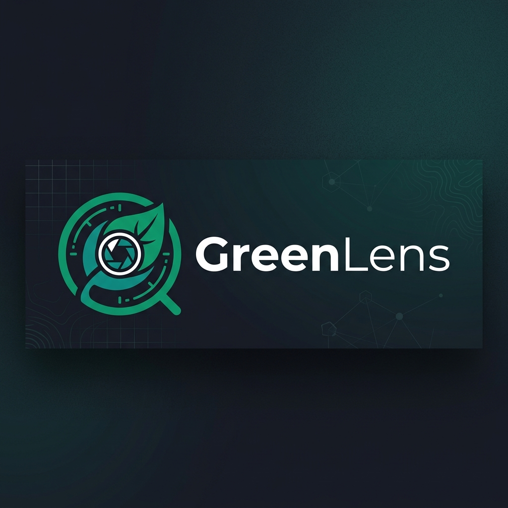
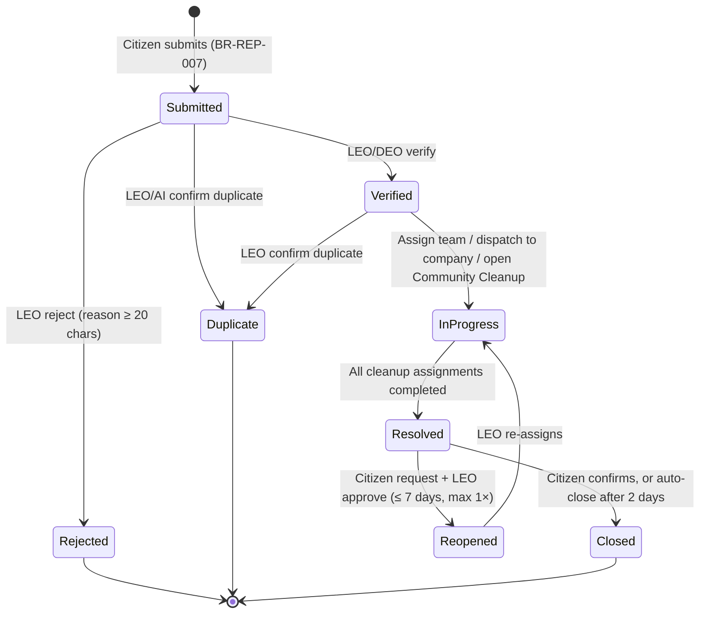
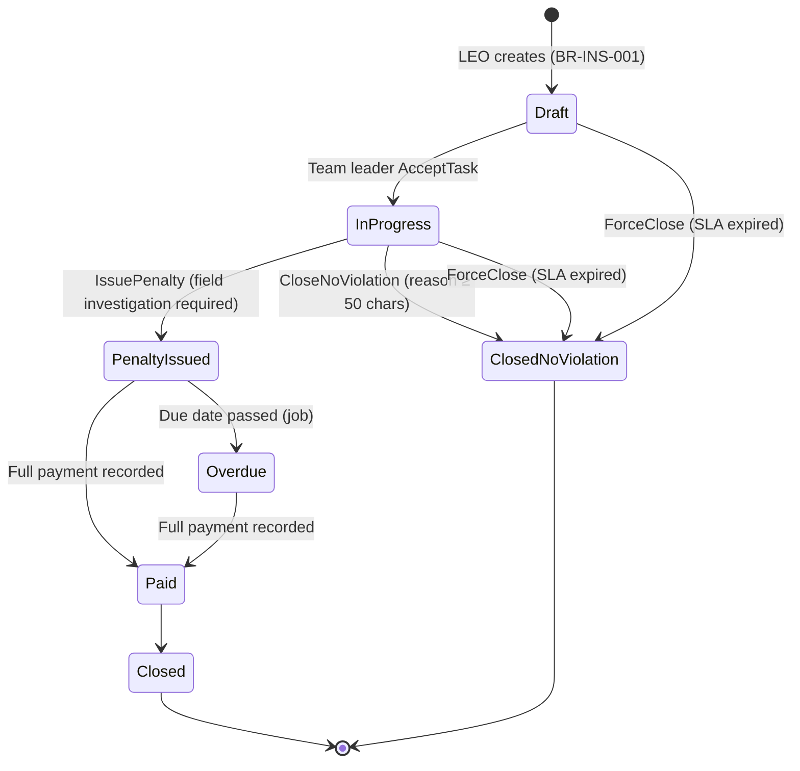
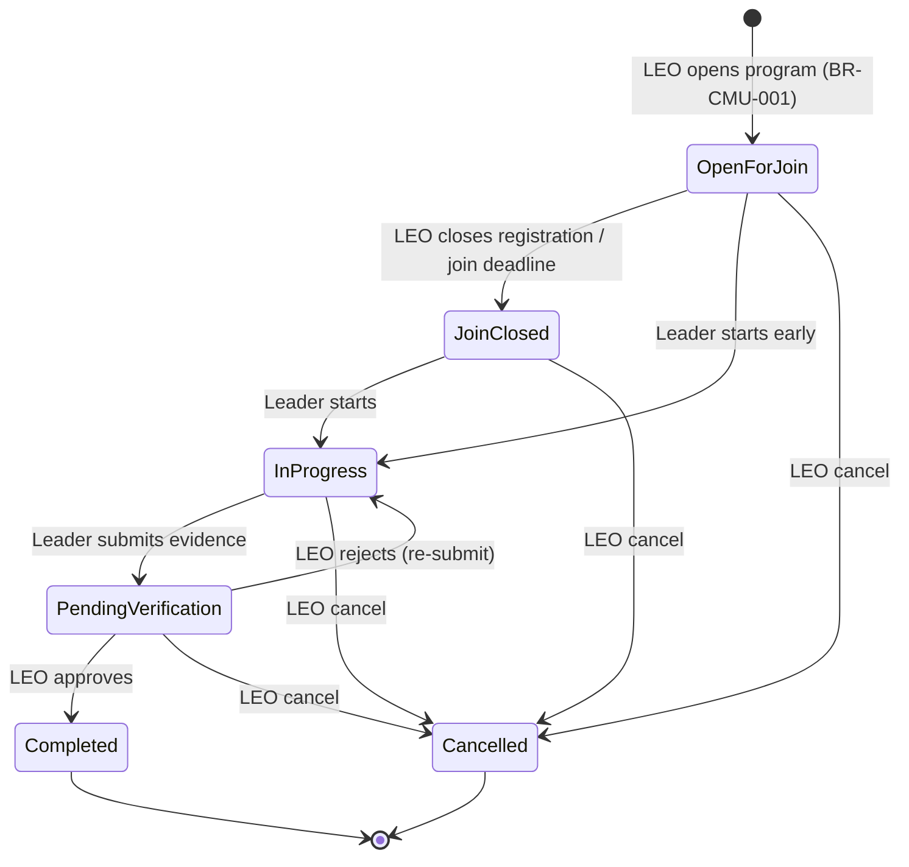
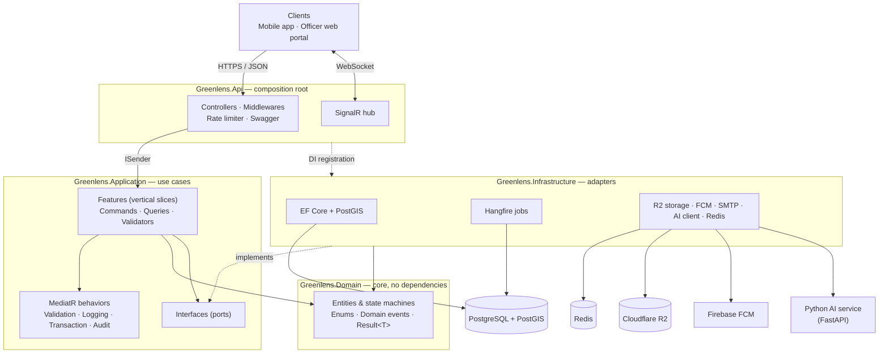

<p align="center">
  
</p>

<h1 align="center">GreenLens — Backend Service</h1>

<p align="center">
  <strong>Crowdsourced Application for Reporting Environmental Pollution</strong><br/>
  <em>A citizen app for reporting waste and pollution hotspots</em>
</p>

<p align="center">
  <a href="https://github.com/Capstonne-Project/greenlens-service/actions/workflows/ci.yml"></a>
</p>

<p align="center">
  
  
  
  
  
  
</p>

<p align="center">
  
  
  
  
  <a href="LICENSE"></a>
</p>

> [!NOTE]
> **The demo server is currently offline.** The hosted environment used during the capstone has been shut down, so the public URLs below no longer respond. Use [Run locally with Docker Compose](#run-locally-with-docker-compose) to start the API on your machine.

---

## 📋 Table of Contents

- [Overview](#-overview)
- [My Contributions](#-my-contributions)
- [Business Rules at a Glance](#-business-rules-at-a-glance)
- [Features](#-features)
- [State Machines](#-state-machines)
- [Architecture](#️-architecture)
- [Tech Stack](#️-tech-stack)
- [Getting Started](#-getting-started)
- [Project Structure](#-project-structure)
- [API Documentation](#-api-documentation)
- [Testing](#-testing)
- [AI Agent Configuration](#-ai-agent-configuration)
- [Contributing](#-contributing)
- [License](#-license)

---

## 🌍 Overview

**GreenLens** is a crowdsourcing platform that lets citizens report environmental pollution (photos + GPS), shows reports on a public map, and tracks every report transparently from submission to cleanup, inspection and penalty.

The backend owns the core business logic: **authentication**, **report lifecycle**, **routing to ward-level offices**, **cleanup & inspection workflows**, **environmental service companies**, **community cleanup events**, **geo-queries**, **gamification**, **AI integration**, **notifications**, and **analytics**.

| Metric           | Target              |
| ---------------- | ------------------- |
| Concurrent Users | 5,000 CCU           |
| Report Scale     | 100,000+ reports    |
| API Latency      | p95 < 2 seconds     |
| Uptime           | ≥ 99.5% / month     |
| Recovery         | RPO ≤ 24h, RTO ≤ 4h |
| Localization     | vi-VN, en-US        |

> **Project Code:** SU26SE049 — FPT University capstone, Semester SU26

---

## 👨‍💻 My Contributions

**Trần Trung Hiếu** ([@HieuTrannn](https://github.com/HieuTrannn)) — Backend Developer

I led the backend and built most of it. The exception is the **map module** (public map data, citizen map with provinces/wards, ward-boundary import, heatmap and hotspot views), which was built by my teammate **Lê Phúc Hậu** ([@phuchau23](https://github.com/phuchau23)). He also built the admin/DEO/company **analytics dashboards** and co-built parts of Community Cleanup, the catalog, AI report descriptions (Gemini) and GPS checks on progress updates.

### What I built

- **Architecture & foundations** — Clean Architecture solution (Domain / Application / Infrastructure / Api), CQRS with MediatR pipeline behaviors, `Result<T>` error model mapped to a single response envelope, FluentValidation, and EF Core 9 + PostGIS persistence with migrations.
- **Auth & accounts** — JWT access tokens with hashed, rotating refresh tokens, Google SSO, email OTP, password reset, login lockout, temporary passwords for provisioned accounts, soft delete with a 90-day restore window.
- **Report lifecycle** — domain-enforced state machine (`Submitted → Verified → InProgress → Resolved → Closed`, with `Rejected`, `Duplicate` and `Reopened`), automatic routing to the ward office by GPS, the citizen reopen-request → LEO approval flow, drafts, idempotent submit, and Redis sliding-window rate limits.
- **Duplicate & recurrence detection** — PostGIS `ST_DWithin` matching (same category, ≤ 25 m), then a background AI image comparison, plus detection of repeat violations near recently closed reports.
- **Officer, cleanup & inspection workflows** — verify / reject / assign / dispatch to companies, multi-team assignments with accept/decline/check-in/progress/complete, and the full InspectionReport process (field checklist → penalty → full payment → close) with SLA tracking.
- **Environmental service companies** — company onboarding, contract periods and renewal, service areas, company teams and staff, and cascading deactivation that reassigns open work.
- **Notifications** — in-app notifications over SignalR, FCM push and SMTP email, admin-editable bilingual templates, user preferences and a per-type daily cap.
- **Gamification, comments, administration & privacy** — points, levels, badges and leaderboard snapshots; threaded comments with media, likes and a profanity filter; system settings, audit log, moderation, penalty framework; data consent and retention.
- **Delivery** — Dockerfile, GitHub Actions build → GHCR → VPS deploy with automatic rollback, Cloudflare Tunnel/WAF, and most of the automated test suite.

### By the numbers

Counted from the code on `develop`. Totals cover the whole repository; the map module is listed separately.

| What | Count | Where it was counted |
| ---- | ----- | -------------------- |
| REST endpoints | **305** in **24** controllers (**300** in **22** controllers outside the map module) | `[Http*]` attributes in `src/Greenlens.Api/Controllers` |
| Real-time hub | **1** SignalR hub (`/hubs/notifications`) | `Program.cs` |
| MediatR handlers | **288** (156 commands + 132 queries), **95** validators | `src/Greenlens.Application/Features` |
| Hangfire background jobs | **18** (15 recurring + 3 fire-and-forget) | `src/Greenlens.Infrastructure/BackgroundJobs`, `UseRecurringJobs()` |
| Notification types | **59** `NotificationType` values | `src/Greenlens.Domain/Enums/NotificationType.cs` |
| Automated tests | **558** (143 domain unit + 377 application unit + 38 integration) | `dotnet test --list-tests` |
| Business rules specified | **185** rules in **16** modules | [`SU26SE049_BusinessRules_v2_0.md`](docs/BusinessRule/SU26SE049_BusinessRules_v2_0.md) |

---

## 📐 Business Rules at a Glance

The system is specified in [**Business Rules v2.0**](docs/BusinessRule/SU26SE049_BusinessRules_v2_0.md). Every handler, validator and job that implements a rule cites its `BR-<MODULE>-<NNN>` ID in XML docs, and tests carry the ID in their name (for example `..._BR_REP_001`).

| Module | Prefix | Rules | Scope |
| ------ | ------ | ----: | ----- |
| Authentication & Account | `BR-AUTH` | 24 | Registration, login & lockout, Google SSO, sessions, password reset, profile, account delete/restore |
| Organization & Routing | `BR-ORG` | 14 | Department (province) / LocalOffice (ward) model, GPS-based routing, 24h intake SLA, team invitations |
| Pollution Report | `BR-REP` | 29 | Report creation, state machine, reopen flow, duplicate & recurrence detection, waste tags, overdue |
| Map & Location | `BR-MAP` | 4 | Public GPS rounding, map cache, filters, heatmap & hotspots |
| Environmental Officer | `BR-OFF` | 9 | Segregation of duties, verification & resolution SLA, priority score, assign / dispatch / escalate |
| Cleanup Team | `BR-CLN` | 9 | Assignment, check-in ≤ 200 m, before/after images, progress, escalate, decline |
| Community Cleanup | `BR-CMU` | 13 | LEO-opened volunteer events, join/withdraw, check-in ≤ 500 m, evidence review |
| Inspection Team | `BR-INS` | 21 | InspectionReport checklist, violators, penalties, full payment, inspection SLA |
| Service Companies | `BR-CMP` | 13 | Company onboarding, contract lifecycle & renewal, teams & staff, cascade deactivation |
| Notifications | `BR-NTF` | 6 | Channels (in-app, push, email), trigger types, anti-spam, language, idempotent dispatch |
| Comments | `BR-CMT` | 6 | Threaded comments, media, profanity filter, edit window, likes, duplicate merge |
| Gamification | `BR-GAM` | 8 | Points, levels, badges, featured badge, fraud lock, leaderboard, streaks |
| AI Service | `BR-AI` | 5 | Image classification, duplicate image compare, waste-tag suggestions, EXIF anti-fraud, timeout |
| Administration | `BR-ADM` | 13 | Users & roles, catalogs, moderation, templates, penalty framework, audit log |
| Data & Privacy | `BR-DAT` | 5 | Password hashing, soft delete, retention, hard delete, data consent |
| Non-functional | `BR-SYS` | 6 | Latency, object storage, uptime, rate limits, scale, i18n |
| **Total** | | **185** | |

---

## ✨ Features

### 👥 Actors

BR v2.0 defines 10 actors; 8 are human roles that can be assigned to a user account.

| Actor | Capabilities |
| ----- | ------------ |
| 🧑 **Citizen** | Submit reports with photos + GPS, track status, request reopen, comment, join community cleanups, earn points & badges |
| 🏛️ **Department Env. Officer (DEO)** | Province level: common queue for wards not yet onboarded, company onboarding & contracts, province KPIs |
| 👮 **Local Env. Officer (LEO)** | Ward level: verify/reject, assign cleanup teams, dispatch to companies, open community cleanups, create inspection reports |
| 🏢 **Company Manager** | Manage company teams & staff, assign teams to dispatched reports |
| 👷 **Company Staff** | Carry out company cleanup tasks (same flow as Cleaner) |
| 🧹 **Cleaner** | Accept/decline tasks, GPS check-in, before/after photos, progress updates, lead community cleanups |
| 🕵️ **Inspector** | Field investigation checklist, issue penalties, close with no violation |
| 🔧 **System Administrator** | Users & roles, catalogs, system settings, templates, moderation, audit logs |
| 🤖 **AI Service** *(automated)* | Classify images, compare duplicates, suggest waste tags, flag suspicious EXIF |
| 🌐 **Community Organization** *(optional)* | View the public map, use open data |

### 🔄 Report Lifecycle (summary)

A report moves `Submitted → Verified → InProgress → Resolved → Closed`. An LEO can **reject** it (reason ≥ 20 chars) or mark it as a **duplicate**. A resolved report closes when the citizen confirms it, or **automatically after 2 days**. Within **7 days** of resolution the citizen can request a reopen; if the LEO approves, the report goes to a separate **`Reopened`** state and then back to `InProgress`. A report can be reopened **at most once** (`Report.MaxApprovedReopens = 1`). The auto-close days, reopen window and reopen limit are admin-configurable system settings with these defaults. See the [state diagrams](#-state-machines).

### 🗺️ Map & Geospatial *(map module by Lê Phúc Hậu)*

- Public map endpoints for viewport reports and summaries (`/v1/map/*`), plus a citizen map by province → ward → reports with a ward risk level (`/v1/citizen-map/*`)
- Ward-boundary GeoJSON import; GPS → ward lookup with PostGIS point-in-polygon for report routing
- Heatmap grid in the admin geographic dashboard
- Public GPS rounded to 4 decimals (≈ 11 m) for privacy

### 🏆 Gamification

- Points per action (verified +10, resolved +20, community cleanup +15, …) with idempotent awards
- 5 levels, milestone / streak / community / level badges, featured badge
- Daily leaderboard snapshots; admin fraud lock that deducts points

---

## 🔁 State Machines

From appendices A–C of [BR v2.0](docs/BusinessRule/SU26SE049_BusinessRules_v2_0.md). The transitions are enforced in the domain entities (`Report`, `InspectionReport`, `CommunityCleanupEvent`), not in the handlers.

### A. Report



### B. InspectionReport



Field checklist: `AcceptTask → ConfirmArrival (optional) → SubmitFieldInvestigation → IssuePenalty | CloseNoViolation`. SLA: Critical 3d / High 5d / Medium 7d / Low 10d. (`InspectionStatus.PartiallyPaid` still exists for legacy data; since v2.0 only full payments are accepted.)

### C. Community Cleanup



---

## 🏗️ Architecture

GreenLens follows **Clean Architecture** with a strict dependency rule: dependencies point inward, and Domain references nothing.



### Key Patterns

| Pattern             | Implementation                                                      |
| ------------------- | ------------------------------------------------------------------- |
| **CQRS**            | Commands (mutate) + Queries (read) via MediatR                      |
| **Result Pattern**  | `Result<T>` for business logic, exceptions only for infrastructure  |
| **Vertical Slices** | Each use case = 1 folder (Command + Handler + Validator + Response) |
| **Domain Events**   | State transitions raise events; side effects via MediatR notification handlers + Hangfire |
| **Rich domain model** | State machines live in entities (`Report.Verify()`, `InspectionReport.IssuePenalty()`, …); no public status setters |

---

## 🛠️ Tech Stack

| Layer                | Technology                                                                 |
| -------------------- | -------------------------------------------------------------------------- |
| **Runtime**          | .NET 9 (C# 13)                                                             |
| **Web API**          | ASP.NET Core 9 — Controller-based                                          |
| **CQRS**             | MediatR (commands, queries, domain event notifications)                    |
| **ORM**              | Entity Framework Core 9 + NetTopologySuite                                 |
| **Database**         | PostgreSQL 16 + PostGIS (`postgis/postgis` image)                          |
| **Cache**            | Redis (required in production; optional in dev, with in-memory fallbacks)  |
| **Object Storage**   | Cloudflare R2 (S3-compatible via AWSSDK.S3, presigned uploads)             |
| **Background Jobs**  | Hangfire (PostgreSQL storage)                                              |
| **Real-time**        | SignalR (notification hub)                                                 |
| **Auth**             | Custom JWT Bearer HS256 (24h access / 30d refresh, hashed in DB), Google SSO |
| **Validation**       | FluentValidation (input) + business rules in handlers                      |
| **Mapping**          | LINQ `.Select()` projection + manual DTO construction                      |
| **Security**         | bcrypt.net-next (password hashing)                                         |
| **Push**             | Firebase Admin SDK (FCM)                                                   |
| **Email**            | SMTP                                                                       |
| **AI Integration**   | Python FastAPI service (HTTP client — classify / duplicate compare)        |
| **Media processing** | MetadataExtractor (EXIF), FFMpegCore (video transcode)                     |
| **Rate limiting**    | ASP.NET Core `RateLimiter` (global API) + Redis sliding window (submit)    |
| **Logging**          | Serilog (Console in dev; configurable sinks)                               |
| **API Docs**         | Swashbuckle (OpenAPI 3.0)                                                  |
| **Testing**          | xUnit + FluentAssertions + NSubstitute + Testcontainers + Respawn          |
| **CI/CD**            | GitHub Actions (PR build + test; deploy to VPS via GHCR on `main`)         |

---

## 🚀 Getting Started

### Prerequisites

| Tool                                                | Version                  |
| --------------------------------------------------- | ------------------------ |
| [.NET SDK](https://dotnet.microsoft.com/download)   | 9.0+                     |
| [Docker](https://www.docker.com/)                   | 24+ (database + Testcontainers) |
| PostgreSQL + PostGIS *(only without Docker)*        | 16+                      |
| Redis *(optional in dev)*                           | 7+                       |

### Run locally with Docker Compose

[`docker-compose.yml`](docker-compose.yml) is the production stack (API + PostGIS + Redis). The quickest local setup uses it to start **only the database**, then runs the API with `dotnet run`:

```bash
# 1. Clone
git clone https://github.com/Capstonne-Project/greenlens-service.git
cd greenlens-service

# 2. Start PostGIS (exposed on 127.0.0.1:5432)
export POSTGRES_DB=greenlens_dev POSTGRES_USER=postgres POSTGRES_PASSWORD=postgres
docker compose up -d postgres

# 3. Configure the API (.env is gitignored and loaded on startup)
cp .env.example .env
#    then edit .env: point ConnectionStrings__DefaultConnection at the database above
#    and set Jwt__Secret (≥ 32 chars). SMTP, R2, Firebase and AI are only needed
#    for email, uploads, push and image classification.

# 4. Run — EF Core migrations are applied automatically on startup
dotnet run --project src/Greenlens.Api
```

The API listens on `http://localhost:5162/v1`, and Swagger UI is at `http://localhost:5162/swagger`. Leave `ConnectionStrings__Redis` empty in dev: the submit rate limiter and caches then fall back to in-memory implementations.

**Full stack in containers** (API + PostGIS + Redis, like production):

```bash
docker build -t ghcr.io/capstonne-project/greenlens-api:latest .
cp .env.example .env.production   # fill in POSTGRES_*, REDIS_PASSWORD, Jwt__Secret, …
touch firebase-adminsdk.json      # mounted by compose; use a real key to enable push
docker compose --env-file .env.production up -d
curl http://127.0.0.1:8080/health
```

### Without Docker

Install PostgreSQL + PostGIS locally, set the connection string with `dotnet user-secrets` (or `.env`), then `dotnet run --project src/Greenlens.Api`.

```bash
cd src/Greenlens.Api
dotnet user-secrets set "ConnectionStrings:DefaultConnection" "Host=localhost;Port=5432;Database=greenlens_dev;Username=postgres;Password=<your-password>"
dotnet user-secrets set "Jwt:Secret" "<at-least-32-characters>"
```

### Environment Variables

| Variable                               | Description                                  | Default            |
| -------------------------------------- | -------------------------------------------- | ------------------ |
| `ConnectionStrings__DefaultConnection` | PostgreSQL connection string                 | —                  |
| `ConnectionStrings__Redis`             | Redis connection string (optional in dev)    | —                  |
| `Jwt__Secret`                          | JWT signing key (≥ 32 chars)                 | —                  |
| `Jwt__Issuer` / `Jwt__Audience`        | JWT issuer / audience                        | see `.env.example` |
| `R2__AccountId`, `R2__AccessKeyId`, `R2__SecretAccessKey`, `R2__BucketName`, `R2__PublicUrl` | Cloudflare R2 storage | — |
| `Smtp__*`                              | SMTP settings for OTP / notification email   | —                  |
| `Firebase__ServiceAccountKeyPath`      | Path to the Firebase Admin SDK JSON          | —                  |
| `Ai__BaseUrl`                          | Python AI service base URL (optional)        | —                  |
| `ASPNETCORE_ENVIRONMENT`               | Environment name                             | `Development`      |

See [`.env.example`](.env.example) for the full list.

> ⚠️ **Never** commit real secrets (R2 keys, JWT signing key, SMTP password, Firebase key). Use `.env` / `dotnet user-secrets` in dev and environment variables or a secret manager in production.

---

## 📁 Project Structure

```
greenlens-service/
│
├── src/
│   ├── Greenlens.Domain/              # Core business — NO framework dependencies
│   │   ├── Common/                    # BaseEntity, AuditableEntity, Result<T>, domain event base
│   │   ├── Entities/                  # Report, InspectionReport, CommunityCleanupEvent, Company, … (+ domain events)
│   │   ├── Enums/                     # ReportStatus, InspectionStatus, NotificationType, …
│   │   └── Exceptions/                # DomainException
│   │
│   ├── Greenlens.Application/         # Use cases via CQRS (MediatR)
│   │   ├── Common/                    # Behaviors, Interfaces, Errors
│   │   ├── Features/                  # Vertical slices: Auth, Reports, Inspection, Organization,
│   │   │                              #   CommunityCleanup, Notifications, Comments, Gamification,
│   │   │                              #   Admin, Users, Media, Catalog, Analytics, Map, CitizenMap
│   │   └── BusinessRules/             # BR constants & system setting keys
│   │
│   ├── Greenlens.Infrastructure/      # Adapters — DB, R2, Redis, FCM, AI
│   │   ├── Persistence/ · Migrations/ # DbContext, configurations, interceptors, migrations
│   │   ├── Identity/                  # JWT, bcrypt, CurrentUser, Google SSO
│   │   ├── Storage/ · Imaging/ · Video/  # R2 storage, EXIF, image/video processing
│   │   ├── Notifications/             # FCM, SMTP, SignalR hub
│   │   ├── BackgroundJobs/            # Hangfire jobs
│   │   ├── Ai/ · Geo/ · RateLimiting/ · Idempotency/ · Seeders/ · …
│   │   └── DependencyInjection.cs     # All registrations
│   │
│   └── Greenlens.Api/                 # HTTP entry point
│       ├── Controllers/               # 24 API controllers
│       ├── Middlewares/ · Filters/ · RateLimiting/ · Swagger/
│       └── Program.cs
│
├── tests/
│   ├── Greenlens.Domain.UnitTests/
│   ├── Greenlens.Application.UnitTests/
│   └── Greenlens.Application.IntegrationTests/    # Testcontainers (PostgreSQL + PostGIS)
│
├── docs/                              # Business rules, diagrams, FE/BE guides, plans
├── scripts/                           # Dev scripts (e2e smoke test, docx → md, SQL helpers)
├── OVERVIEW.md                        # Detailed architecture guide
├── 00_API_CONVENTIONS.md              # API contract conventions
└── README.md                          # ← You are here
```

> **Note:** `Greenlens.Api.FunctionalTests` (WebApplicationFactory) is part of the planned testing pyramid but has **not been scaffolded yet** — it is not in the repo or `Greenlens.sln`. There are currently 3 test projects (Domain/Application unit + Application integration).

---

## 📡 API Documentation

### Base URL

| Environment | URL                                   |
| ----------- | ------------------------------------- |
| Local       | `http://localhost:5162/v1`            |
| Hosted demo | *Offline — the capstone VPS has been shut down* |

### Response Envelope

**All** responses follow this format:

```json
{
  "code": "SUCCESS",
  "message": "Operation completed successfully",
  "status": 200,
  "data": { ... }
}
```

### Authentication

```http
Authorization: Bearer {access_token}
Content-Type: application/json
Accept-Language: vi-VN
```

| Token         | Lifetime   |
| ------------- | ---------- |
| Access Token  | 24 hours   |
| Refresh Token | 30 days    |
| OTP (Email)   | 10 minutes |

### Key Endpoints

| Method | Path                                                   | Description                         | Auth        |
| ------ | ------------------------------------------------------ | ----------------------------------- | ----------- |
| `POST` | `/v1/auth/register`                                    | Register citizen account            | Public      |
| `POST` | `/v1/auth/login`                                       | Login, receive JWT                  | Public      |
| `POST` | `/v1/auth/google-login`                                | Google SSO                          | Public      |
| `POST` | `/v1/auth/refresh-token`                               | Rotate refresh token                | Public      |
| `POST` | `/v1/reports`                                          | Submit pollution report             | Citizen     |
| `GET`  | `/v1/reports/{id}`                                     | Get report details                  | Bearer      |
| `PUT`  | `/v1/reports/{id}/verify`                              | Verify report                       | LEO / Admin |
| `PUT`  | `/v1/reports/{id}/reject`                              | Reject report                       | LEO / Admin |
| `POST` | `/v1/reports/{id}/assign`                              | Assign cleanup team(s)              | LEO / Admin |
| `PUT`  | `/v1/reports/{id}/close`                               | Citizen confirms resolution         | Reporter    |
| `POST` | `/v1/reports/{id}/reopen-requests`                     | Request reopen with evidence        | Reporter    |
| `POST` | `/v1/reports/{id}/reopen-requests/{requestId}/approve` | Approve reopen                      | LEO / Admin |
| `GET`  | `/v1/map/reports`                                      | Public map reports in a viewport    | Public      |
| `GET`  | `/v1/citizen-map/provinces`                            | Citizen map — provinces             | Public      |
| `GET`  | `/v1/gamification/leaderboard`                         | Leaderboard                         | Bearer      |
| `WS`   | `/hubs/notifications`                                  | Real-time notifications (SignalR)   | Bearer      |

> 📖 The full API (305 endpoints) is documented in Swagger UI at `/swagger` when running locally.

### Rate Limits

| Scope              | Limit                                                        |
| ------------------ | ------------------------------------------------------------ |
| Anonymous API      | 60 req/min/IP (ASP.NET Core RateLimiter)                     |
| Authenticated user | 300 req/min/user (ASP.NET Core RateLimiter)                  |
| Submit report      | 5/hour, 20/24h per citizen (Redis, in-memory fallback in dev) |
| Login attempts     | 5 failed attempts → 30-minute lock; CAPTCHA required after repeated failures (admin-configurable) |

---

## 🧪 Testing

### Testing Pyramid

| Layer              | Ratio | Stack                                             |
| ------------------ | ----- | ------------------------------------------------- |
| **Unit**           | ~70%  | xUnit + FluentAssertions + NSubstitute            |
| **Integration**    | ~25%  | + Testcontainers (PostgreSQL + PostGIS) + Respawn |
| **Functional/E2E** | ~5%   | + WebApplicationFactory *(planned — project not scaffolded yet)* |

### Test projects (in `Greenlens.sln`)

| Project | Type | Tests |
| ------- | ---- | ----: |
| `Greenlens.Domain.UnitTests` | Unit | 143 |
| `Greenlens.Application.UnitTests` | Unit | 377 |
| `Greenlens.Application.IntegrationTests` | Integration (Testcontainers — needs Docker) | 38 |

CI runs `dotnet build` and `dotnet test` on every pull request ([`ci.yml`](.github/workflows/ci.yml)).

### Running Tests

```bash
# Run all tests (3 projects in the solution; integration tests need Docker running)
dotnet test

# Run a specific test project
dotnet test tests/Greenlens.Domain.UnitTests/
dotnet test tests/Greenlens.Application.UnitTests/
dotnet test tests/Greenlens.Application.IntegrationTests/

# Run tests for a specific business rule
dotnet test --filter "FullyQualifiedName~BR_REP_001"

# Run with coverage
dotnet test --collect:"XPlat Code Coverage"
```

### Test Naming Convention

```csharp
[Fact]
public async Task SubmitReport_NoPhoto_ReturnsValidationError_BR_REP_001()
```

Pattern: `{Method}_{Scenario}_{ExpectedResult}_{BR_ID}`

> The goal is at least one test per business rule (`BR-*-NNN`).

---

## 🤖 AI Agent Configuration

This repository includes configuration for AI coding assistants, all enforcing the conventions in [`CLAUDE.md`](CLAUDE.md), [`OVERVIEW.md`](OVERVIEW.md) and [`00_API_CONVENTIONS.md`](00_API_CONVENTIONS.md):

```
.agents/skills/      # Workflow skills (plan, build, test, release) + GreenLens patterns
                     #   (feature slice, domain entity, background job, integration test, …)
.cursor/
├── rules/           # 12 enforcement rules (.mdc)
├── agents/          # 8 specialized agents
├── skills/          # 6 workflow skills
└── hooks/           # 7 automated hooks (PowerShell)
CLAUDE.md, AGENTS.md # Project instructions for Claude Code / other agents
```

---

## 🤝 Contributing

### Branch Strategy

Feature branches merge into `develop` through pull requests; `develop` is promoted to `main`, which deploys to the VPS.

```
main ←── develop ←── feature/<ticket>-<slug>
                 ←── fix/<ticket>-<slug>
                 ←── chore/<slug> · docs/<slug>
```

### Commit Convention

[Conventional Commits](https://www.conventionalcommits.org/) with BR IDs:

```
feat(reports): submit report endpoint (BR-REP-001..010)
fix(auth): refresh token rotation (BR-AUTH-017)
chore(infra): add SLA breach background job (BR-OFF-003)
```

### PR Checklist

- [ ] CI is green (`dotnet build` + `dotnet test`)
- [ ] Code follows Clean Architecture dependency rule
- [ ] All handlers have BR ID XML comments
- [ ] Response envelope `{code, message, status, data}` used
- [ ] Unit test: happy path + ≥ 1 error case
- [ ] Integration test with DB
- [ ] Swagger annotations complete
- [ ] BR IDs listed in commit message
- [ ] ≥ 1 reviewer approved

### Definition of Done

See full checklist in [`00_API_CONVENTIONS.md §12`](00_API_CONVENTIONS.md).

---

## 📜 License

Released under the [MIT License](LICENSE). Built as part of the FPT University capstone program (SU26SE049).

---

<p align="center">
  <strong>GreenLens</strong> — Making environmental reporting transparent and accessible 🌱
</p>
